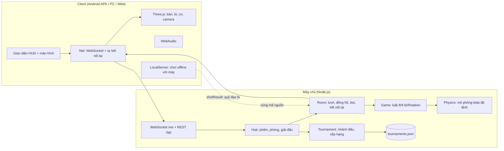

# 01 · Kiến trúc hệ thống

## Sơ đồ



## Nguyên tắc cốt lõi
1. **Máy chủ có thẩm quyền.** Client chỉ gửi *ý định* (góc, lực, xoáy, vị trí đặt bi cái). Máy chủ kiểm tra lượt, giới hạn giá trị, mô phỏng vật lý, áp luật và trả kết quả. Client không thể tự quyết kết quả.
2. **Mô phỏng một lần, phát lại ở mọi máy.** Máy chủ chạy vật lý (bước 1/480 s, tất định) rồi gửi *quỹ đạo 30 Hz* của từng bi + danh sách sự kiện (va chạm, băng, lỗ). Cả 2–4 người thấy đúng cùng một cú đánh, kể cả ping cao — không cần đoán/đồng bộ từng khung hình qua mạng. Sau khi phát xong, client đối chiếu với `snapshot` của máy chủ.
3. **Vật lý riêng cho bida** (`GameServer/src/physics.ts`): bi trượt → lăn (ma sát Coulomb), cản lăn, xoáy dọc/ngang, va chạm bi–bi có độ nảy và ma sát tiếp tuyến, va chạm băng ghép xoáy ngang, vùng hút của lỗ. Không dùng rigidbody tổng quát.
4. **Camera không ảnh hưởng vật lý** — chỉ nằm ở client.

## Cấu trúc thư mục
```
Bia-dee/
├─ GameClient/        client 3D (Vite + Three.js)
│  ├─ src/{main,scene,net,audio,local}.ts, styles.css
│  ├─ capacitor.config.ts   đóng gói APK
│  └─ desktop/              vỏ Electron cho PC
├─ GameServer/src/    physics.ts, rules.ts, game.ts, rack.ts, ai.ts
├─ Backend/src/       main.ts, server.ts, hub.ts, room.ts, tournament.ts
├─ Shared/src/        protocol.ts (kiểu thông điệp, kích thước bàn)
├─ Tests/             physics / rules / tournament / e2e (mạng thật) / ui (Playwright)
├─ Deployment/        Dockerfile, docker-compose.yml, Caddyfile
├─ Documentation/     tài liệu này
├─ Design/            (tài nguyên thiết kế — icon nằm ở GameClient/public)
└─ .github/workflows/ ci.yml, android.yml, desktop.yml
```

## Quyết định đổi Unity → Three.js
Đặc tả đề xuất Unity 6 nhưng cho phép đổi nếu báo cáo lý do. Lý do đổi:
- **Build APK tự động không cần giấy phép Unity.** Build Unity trên GitHub Actions cần tài khoản/giấy phép Unity và bước kích hoạt thủ công — người không chuyên kỹ thuật dễ kẹt. Three.js + Capacitor build bằng Actions miễn phí, không cần cấu hình.
- **Kiểm thử được thật.** Môi trường phát triển không chạy được Unity Editor; client web chạy trong Chromium nên được kiểm thử tự động (2 người chơi, giải đấu, offline…).
- **Một ngôn ngữ, một bộ luật.** Luật và vật lý viết bằng TypeScript chạy chung cho máy chủ và chế độ offline trong app — không bị lệch giữa client và server.
- **PC miễn phí:** cùng mã nguồn chạy trên trình duyệt hoặc đóng gói Electron.

Đánh đổi: đồ họa Three.js đơn giản hơn Unity về hiệu ứng nâng cao; nếu sau này cần đồ họa AAA có thể viết client Unity mới dùng lại nguyên Backend/Game Server và giao thức trong `Shared/`.
